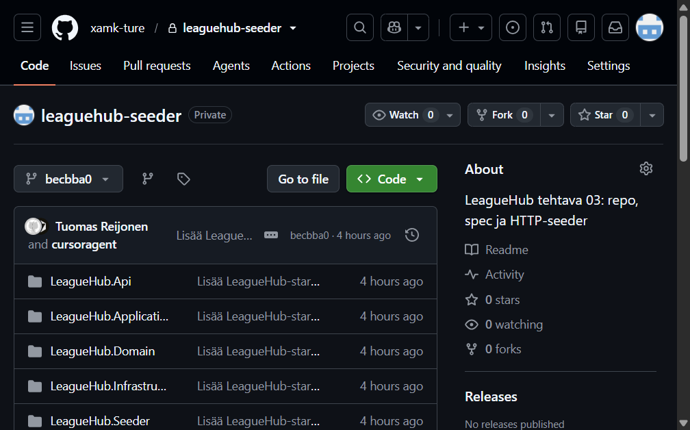
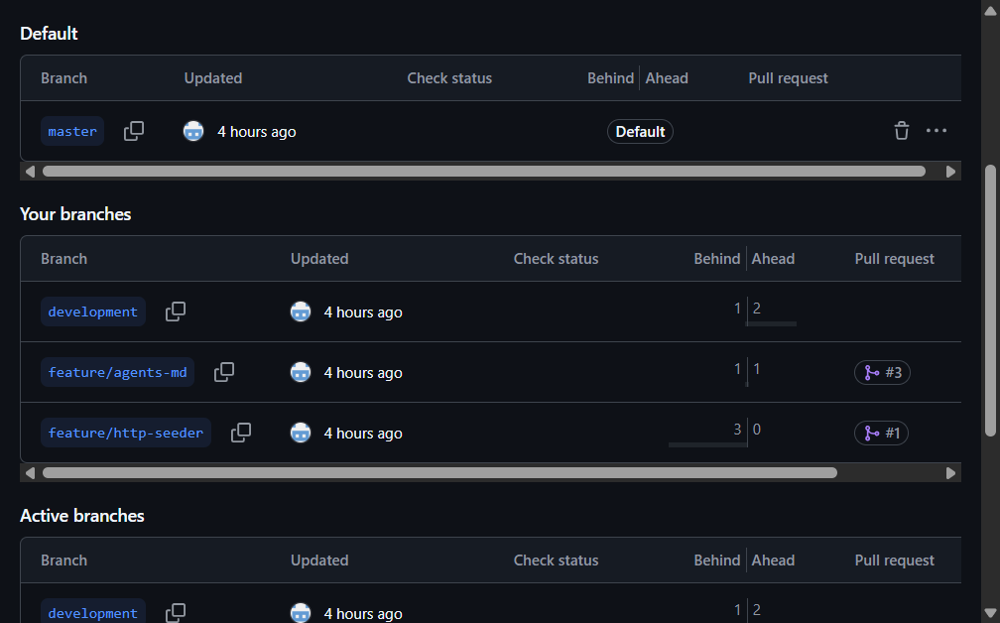
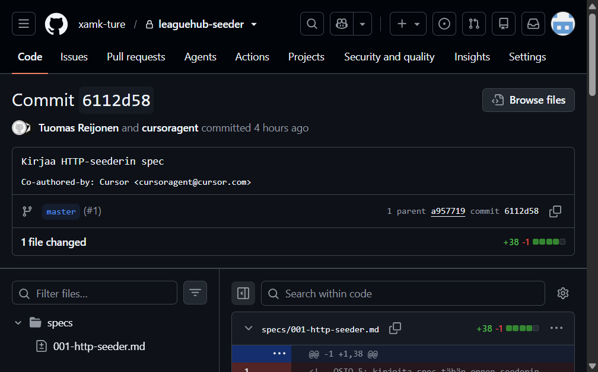
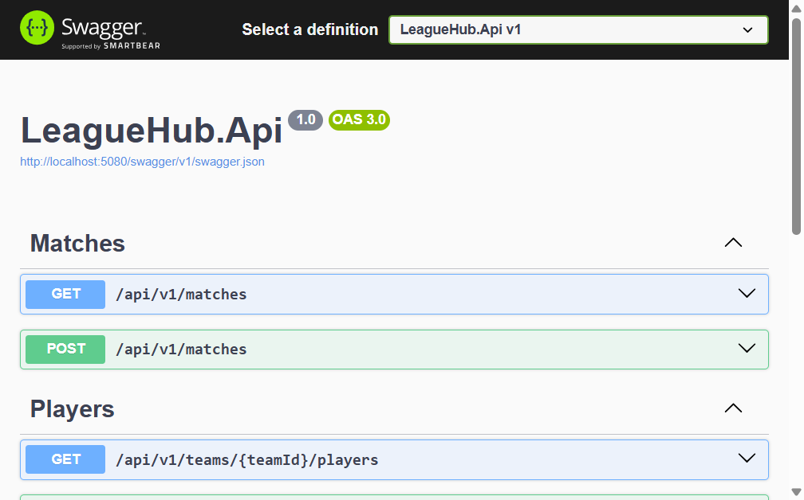
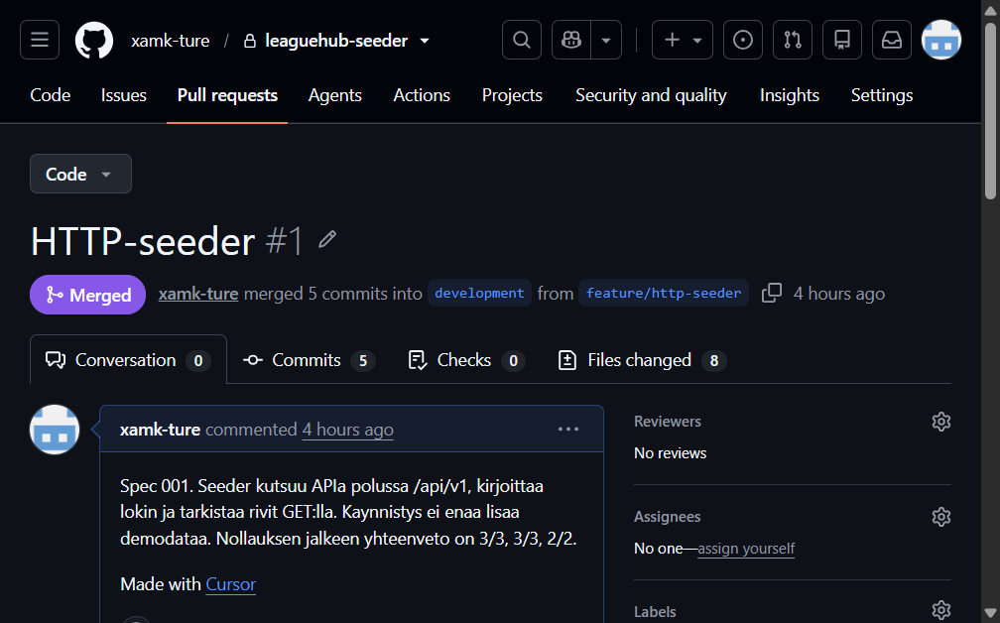
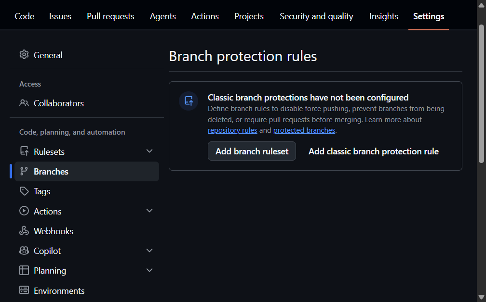
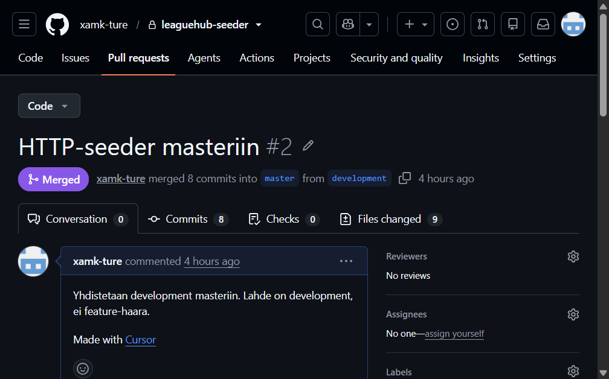
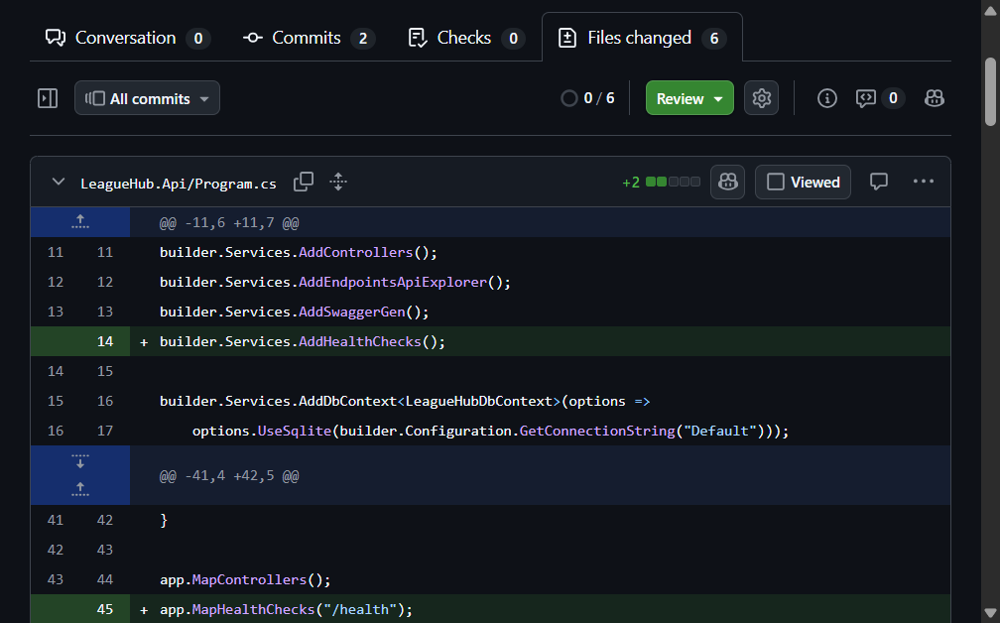

# 03 — Repo ja HTTP-seeder

Tässä tehtävässä opit viemään muutoksen alusta loppuun samalla tavalla kuin oikeassa ohjelmistotuotteessa: GitHub-repo, haarat, spec ennen koodia ja pull requestit. Samalla rakennat **seederin** — pienen erillisen ohjelman, joka lisää demodatan (joukkueet, pelaajat, ottelut) tietokantaan API:n kautta.

**Lähtötilanne.** Saat valmiin **starter**-kansion. Se on sama LeagueHub-rakenne kuin kerralla 2 (Domain, Application, Infrastructure, API), mutta valmiiksi kirjoitettuna — [kerran 2](../02-CleanArchitecture/README.md) omaa työtä ei jatketa, se jää omaan repoonsa. Starterissa on yksi ongelma: demodata lisätään kantaan aina, kun API käynnistyy. Sinä siirrät demodatan lisäämisen omaan ohjelmaan, **HTTP-seederiin**, joka kutsuu käynnissä olevaa APIa. Silloin sama komento toimii mihin tahansa ympäristöön — paikalliseen nyt, pilveen myöhemmin — kun vain osoite vaihtuu.

**Malli on oikea tuote.** [MyLeaguen](https://github.com/xamkfi/myleague-app) seeder [`src/tools/Seeder`](https://github.com/xamkfi/myleague-app/tree/development/src/tools/Seeder) on juuri tällainen erillinen ohjelma, ja MyLeaguen haarat ovat `development` ja `master` — sama jako tehdään tässä. MyLeaguea ei kloonata.

**Miten etenet.** Avaa **yksi osio kerrallaan**. Jokaisessa osiossa sama asia tehdään kahdella tavalla, valitse toinen:

- **Miten käsin** — komennot ja koodi ovat näkyvissä. Kirjoita ne kohtiin, joissa starterissa lukee kommentti `OSIO N`.
- **Miten tekoälyn kanssa** — valmis promptti samaan osioon. Checkpointin ajat aina itse.

Älä anna koko tehtävää yhdellä promptilla: repo, spec ja seeder tarkistetaan eri kohdista, ja yksi iso promptti sekoittaa ne. Tätä tehtävää **ei palauteta**, mutta se pohjustaa suoraan [välitehtävää](../Valitehtava.md).

**Työkalut:** Visual Studio Community on C#-IDE. Git- ja GitHub-komennot kirjoitetaan päätteeseen. VS Code / Cursor on tämän tiedoston lukutila.

---

## Teoria tehtävässä — kartta

| Käsite | Yhdellä lauseella | Missä avataan |
|--------|-------------------|---------------|
| **master / development** | Kaksi pitkäikäistä haaraa: julkaistu haara ja työhaara | Osio 3 |
| **Pull request (PR)** | Ehdotus yhdistää haara toiseen | Osio 3 ja 11 |
| **Feature-haara** | Yhden muutoksen haara, lähtee developmentista | Osio 4 |
| **Spec** | Päätökset tiedostona ennen koodia | Osio 5 |
| **HTTP-seeder** | Oma ohjelma, joka lisää demodatan API:n kautta | Osio 6–7 |
| **Loki** | Konsolirivi: luotiinko rivi vai oliko se jo | Osio 7 |
| **Integraatiotesti** | Koe, joka ajaa useaa osaa yhdessä oikean rajan yli | Osio 8 |
| **API-versio** | Polku `api/v1` on lupaus, että tämä muoto pysyy | Osio 10 |
| **Haarasuojaus** | GitHub kieltää suoran pushin | Osio 12 |
| **Tekoäly** | Rajattu promptti, checkpoint itse | Jokainen osio, kooste osiossa 15 |
| **AGENTS.md** | Repon juuren ohje, jonka uusi sessio lukee ensin | Osio 13 |
| **Savutesti** | Pienin tarkistus: GET APIn `/health`-osoitteeseen, tulos paluukoodina | Osio 14 |
| **CLI** | Komento, jonka tulosteen ja paluukoodin voi lukea | Osiot 14 ja 15 |

<details>
<summary>Lisämateriaali</summary>

- [MyLeague — Database seeding](https://github.com/xamkfi/myleague-app#database-seeding)
- [MyLeague Seeder](https://github.com/xamkfi/myleague-app/blob/development/src/tools/Seeder/README.md)
- Luento: [Ohjelmistoarkkitehtuuri](../01-Kerrosarkkitehtuuri/ohjelmistoarkkitehtuuri.md), taso "Versionhallinta ja kehitysprosessi"

</details>

---

## Mitä rakennat

1. GitHub-repo, jossa ensimmäinen commit on koskematon starter haarassa `master`.
2. Haara `development`.
3. Haara `feature/http-seeder`, spec, HTTP-seeder ja reittien versio `api/v1`.
4. Kaksi pull requestia: feature → development, development → master.
5. Suojat, joiden jälkeen kumpaankaan haaraan ei pushata suoraan.
6. `AGENTS.md` repon juureen — viedään omalla feature-haaralla ja PR:llä, kun suojat ovat jo päällä.
7. APIn osoite `/health` ja savutesti `LeagueHub.SmokeTest` — komento, joka kertoo paluukoodilla onko API hereillä.

Seederin hyväksytty ajo tulostaa lopuksi:

```text
joukkueet 3/3, pelaajat 3/3, ottelut 2/2
```

Toinen ajo ilman kannan tyhjennystä tulostaa rivit `oli jo` ja saman yhteenvedon. Prosessi päättyy virheeseen, jos jokin specin rivi puuttuu.

---

<details>
<summary>Ohjattu osio 1 — Starter omaksi kansioksi ja ensimmäinen commit</summary>

**Miksi tämä osio?** GitHubiin menee ensin se koodi, jota et ole vielä muuttanut. Silloin historiasta näkee, mitä starter teki ennen seederiä: API lisää demodatan kantaan käynnistyksessä.

Avaa kansio [starter/](starter/). Git-repo tehdään sinne. Repoon ei tule tämän tehtävän README:tä eikä kansiota `examples/`.

<details>
<summary>Miten käsin</summary>

Tarvitset Gitin. Tarkista päätteessä:

```bash
git --version
```

Kansiossa `starter`:

```bash
git init
git branch -M master
git add .
git status
```

`git status` ei saa näyttää `bin/`, `obj/`, `leaguehub.db` eikä sen sivutiedostoja `leaguehub.db-shm` ja `leaguehub.db-wal`. Ne ovat starterin `.gitignore`-tiedostossa. SQLite kirjoittaa sivutiedostot, kun kanta on auki. Kommentti tiedoston alussa viittaa tähän osioon. Avaa `.gitignore` kerran ja lue rivit: käännöstulos syntyy uudestaan joka buildissa, ja tietokantatiedosto on paikallista dataa — kumpikaan ei ole lähdekoodia, joten kumpikaan ei kuulu historiaan.

```bash
git commit -m "Lisää LeagueHub-starter"
```

Jos commit valittaa nimestä, aseta se **vain tähän repoon**:

```bash
git config user.name "Oma Nimi"
git config user.email "oma.sahkoposti@example.com"
```

Aja commit uudestaan. Älä muuta vielä `Program.cs`-tiedostoja.

</details>

<details>
<summary>Miten tekoälyn kanssa</summary>

Avaa agentti kansiossa `starter`. Liitä:

```text
Tee tästä kansiosta git-repo.
Ensimmäinen haara on master.
Älä muuta koodia.
Älä ota mukaan käännöstuloksia äläkä tietokantatiedostoa.
Commit-viesti: Lisää LeagueHub-starter.
Jos tekijän nimeä ei ole asetettu, aseta se vain tähän repoon.
Älä luo vielä GitHub-repoa.
Kerro commitit ja haara, kun olet valmis.
```

Lue tuloste. Yksi commit, haara `master`, ei ylimääräisiä tiedostoja. Jos repo syntyi tehtäväkansion juureen, poista se ja aloita kansiosta `starter`.

</details>

**Checkpoint**

`git log --oneline` näyttää yhden commitin. `git branch` näyttää `master`. Jos listassa on jo seeder-muutoksia, palauta tiedostot starterin versioksi ennen committia — ensimmäisen commitin pitää olla koskematon lähtötila.

</details>

---

<details>
<summary>Ohjattu osio 2 — Repo GitHubiin ja starterin push</summary>

**Miksi tämä osio?** Paikallinen kansio ei ole vielä jaettu historia. Repo luodaan GitHubiin ja starter pushataan sinne ennen kuin development tai feature-haara on olemassa.

<details>
<summary>Miten käsin</summary>

**Tapa A — GitHub CLI (`gh`)**

Asenna tarvittaessa ja kirjaudu. Windowsissa, jos `gh` puuttuu:

```bash
winget install --id GitHub.cli -e --source winget
```

Avaa uusi pääte asennuksen jälkeen.

```bash
gh auth login
```

Valitse GitHub.com, HTTPS, kirjautuminen selaimella. Tarkista: `gh auth status`.

Starter-kansiossa (siellä on `.git`):

```bash
gh repo create leaguehub-seeder --private --source=. --remote=origin --push
```

- `--private` — kurssityö ei ole julkinen.
- `--source=.` — tämä kansio, ei uutta tyhjää kopiota muualle.
- `--remote=origin --push` — kytkee `origin`-nimen ja puskee `master`in.

Komento tulostaa repon osoitteen. Avaa se selaimessa. Tiedostoissa on yhä `DbSeeder`.

**Tapa B — ilman `gh`:tä**

Luo repo GitHubin sivulla: **New repository**. Nimi `leaguehub-seeder`, private. Älä ruksita README:tä, `.gitignore`a etkä lisenssiä. Ne törmäävät starteriin, joka on jo paikallisessa historiassa.

Sivu näyttää osoitteen. Starter-kansiossa, omalla käyttäjänimelläsi:

```bash
git remote add origin https://github.com/KAYTTAJA/leaguehub-seeder.git
git push -u origin master
```

</details>

<details>
<summary>Miten tekoälyn kanssa</summary>

Kirjaudu GitHubiin itse ennen prompttia. Agentti ei kysy salasanaa. Avaa agentti kansiossa `starter` ja liitä:

```text
Luo yksityinen GitHub-repo nimellä leaguehub-seeder tästä kansiosta ja puske master sinne.
Älä tee reposta julkista.
Älä lisää GitHubiin README:tä, .gitignorea tai lisenssiä. Paikallinen historia on jo olemassa.
Älä tee force pushia.
Jos et ole kirjautunut, pysähdy.
Kerro repon osoite, kun olet valmis.
```

Avaa osoite selaimessa. Tiedostoissa on yhä `DbSeeder`. Jos komento kaatui siihen, että remote ei ole tyhjä, poista remote (`git remote remove origin`), luo repo uudestaan ilman README:tä ja anna agentin pushata uudestaan. Force push ei kuulu tähän.

</details>

**Checkpoint**

GitHubin `master` näyttää saman puun kuin paikallinen starter. Jos push valittaa, että remote sisältää työtä jota sinulla ei ole, loit repon README:n kanssa. Poista remote (`git remote remove origin`), luo repo uudestaan tyhjänä ja pushaa uudestaan. Älä käytä force pushia.

Esimerkki ensimmäisestä pushista. Repo on private, ja commit on starter.



</details>

---

<details>
<summary>Ohjattu osio 3 — development, ja mitä pull request tarkoittaa</summary>

**Miksi tämä osio?** `master` on julkaistu haara. MyLeaguessa staging päivittyy haarasta `development` ja tuotanto haarasta `master`. Työ ei ala `master`issa, eikä sitä pushata sinne suoraan sen jälkeen kun suojat ovat päällä. Suojat tulevat vasta osiossa 12, jotta tämä ensimmäinen push ehtii perille.

**Pull request (PR)** on ehdotus: tämän haaran commitit yhdistetään toiseen haaraan. Ehdotuksen voi lukea, ja yhdistäminen on erillinen teko. Suora `git push` masteriin ohittaa ehdotuksen. Siksi myöhemmin masteriin pääsee vain PR:llä, ja sen lähde on `development`.

<details>
<summary>Miten käsin</summary>

Luo työhaara masterista ja puske se:

```bash
git checkout -b development
git push -u origin development
```

GitHubissa on nyt kaksi haaraa ja sama commit molemmissa. PR:ää ei vielä avata — ei ole muutosta, jota ehdottaa.

Kirjoita repon `README.md`:n loppuun tämä päätös:

```markdown
## Haarat

`master` on julkaistu haara. `development` on työhaara.
Muutos tehdään feature-haarassa, joka lähtee developmentista.
Yhdistäminen developmentiin ja masteriin tapahtuu pull requestilla.
Masteriin ei pushata suoraan. Developmentiin ei pushata suoraan sen jälkeen, kun suojat ovat päällä.
```

Commitoi README **development**-haaraan:

```bash
git add README.md
git commit -m "Kuvaa haarat"
git push
```

</details>

<details>
<summary>Miten tekoälyn kanssa</summary>

```text
Luo haara development nykyisestä masterista ja puske se GitHubiin.
Älä avaa pull requestia. Haaroissa ei ole vielä eroa, jota ehdottaa.
Kirjoita README:n loppuun, miten haarat toimivat:
master on julkaistu haara, development on työhaara,
muutos tehdään feature-haarassa joka lähtee developmentista,
yhdistäminen tapahtuu pull requestilla,
masteriin ei pushata suoraan.
Commitoi vain tuo README haaraan development ja puske se.
Älä commitoi masteriin. Älä tee force pushia.
Kerro millä haaralla ollaan.
```

`git branch` näyttää tähteä `development`in kohdalla. Jos agentti commitoi masteriin, olet julkaistulla haaralla. Luo development siitä commitista ja puske se. Älä jatka masterissa.

</details>

**Checkpoint**

`git branch` näyttää tähteä `development`in kohdalla. GitHubin haaravalikossa on `master` ja `development`. Jos teit commitin masteriin, olet työhaaran sijaan julkaistulla haaralla. Luo development tästä commitista (`git checkout -b development`) ja puske se. Älä jatka masterissa.

Esimerkkirepossa näkyvät myös myöhemmät feature-haarat. Tässä osiossa riittää, että `master` ja `development` ovat listalla.



</details>

---

<details>
<summary>Ohjattu osio 4 — Feature-haara seederille</summary>

**Miksi tämä osio?** `master` ja `development` ovat pitkäikäisiä haaroja: ne kuvaavat koko projektin tilaa, eivät yhtä muutosta. **Feature-haara** on lyhytikäinen haara yhtä muutosta varten. Se luodaan developmentista, siihen commitoidaan yhden asian työ, se yhdistetään pull requestilla takaisin, ja sen jälkeen haaran voi poistaa. Nimi kertoo sisällön: `feature/http-seeder` sisältää seederin eikä mitään muuta.

Hyödyt näkyvät tässä tehtävässä kolmessa kohdassa:

- **PR:n diff pysyy luettavana.** Kun haarassa on vain seederin commitit, PR näyttää juuri sen eron. Suoraan developmentiin tehty työ olisi jo työhaarassa — ei olisi ehdotusta, jota lukea.
- **Keskeneräinen työ ei riko muita.** Development pysyy toimivana, vaikka feature-haarassa seeder on puoliksi kirjoitettu. Toinen muutos — kaverin tai toisen agentin — etenee omassa haarassaan törmäämättä sinun keskeneräiseesi.
- **Hylkäys on halpa.** Jos diff paljastaa väärän ratkaisun, vaikka Infrastructure-viittauksen seederissä, korjaus tehdään haaraan tai koko haara hylätään. Työhaara ei ehtinyt likaantua.

Sama malli on agentin valvonnan perusta: agentti työskentelee feature-haarassa, ja sen tuotos luetaan PR:n diffistä ennen kuin se pääsee työhaaraan.

<details>
<summary>Miten käsin</summary>

```bash
git checkout development
git checkout -b feature/http-seeder
```

Kaikki seuraavien osioiden commitit tulevat tähän haaraan. `master` ja `development` eivät saa näitä committeja ennen pull requestia.

</details>

<details>
<summary>Miten tekoälyn kanssa</summary>

```text
Luo developmentista haara feature/http-seeder ja vaihda siihen.
Älä tee committia. Älä puske.
Älä koske koodiin äläkä speciin.
Kerro millä haaralla ollaan.
```

Status-rivillä pitää lukea `feature/http-seeder`. Jos agentti ehti commitoida seederiä developmentiin, sitä ei yhdistetä. Uusi haara luodaan ennen koodia.

</details>

**Checkpoint**

`git status` kertoo haaran `feature/http-seeder`. Jos status kertoo `development`, uutta haaraa ei luotu. Älä commitoi seederiä developmentiin.

</details>

---

<details>
<summary>Ohjattu osio 5 — Spec ennen koodia</summary>

**Miksi tämä osio?** Starterin `specs/001-http-seeder.md` on tyhjä kommentti `OSIO 5`. Spec kirjoitetaan ennen seederin C#-koodia. Se on sopimus: mitä tehdään, mihin sääntö kuuluu, mistä näet että ajo onnistui, ja mihin ei kosketa.

Järjestyksellä on kaksi syytä. Kun spec on historiassa ennen koodia, osion 11 PR:ssä diffiä voi verrata lupaukseen: toteuttiko koodi sen, mitä spec sanoo. Ja seuraavat promptit viittaavat speciin sen sijaan, että sama sääntölista kirjoitettaisiin jokaiseen prompttiin uudestaan. Väärään paikkaan merkitty sääntö on halvin korjata nyt, kun se on yksi rivi taulukossa eikä vielä koodia.

**Spec** sisältää vain nämä:

<details>
<summary>Miten käsin</summary>

1. Käsitteet ja tekemiset
2. Säännön paikka ja miksi
3. Hyväksymiskriteerit
4. Ei-tavoitteet

Korvaa tiedoston sisältö tällä:

```markdown
# Spec 001 — HTTP-seeder

## Käsitteet

- Seeder: erillinen ohjelma, API:n asiakas. Ei kerros.
- Demodata: kolme joukkuetta, kolme pelaajaa, kaksi ottelua.

## Tekemiset

- varmista joukkueet Mikkelin Myrsky, Kouvolan Kiekko, Savonlinnan Sähly
- varmista pelaajat Matti Meikäläinen 7 ja Teppo Testaaja 10 Myrskyyn, Kaisa Kiekkonen 7 Kiekkoon
- varmista ottelut Myrsky–Kiekko ja Kiekko–Sähly

## Säännöt ja paikka

| Sääntö | Paikka | Miksi |
|--------|--------|-------|
| Joukkueella on nimi | Domain, `Team.Create` | Sääntö on jo olemassa. Seeder ei kopioi sitä. |
| Sama nimi ei tule kahdesti | Seeder | Päätös vaatii haun tästä ympäristöstä. |
| Sama pelaaja ei tule kahdesti samaan joukkueeseen | Seeder | Haku rosterista, sitten POST vain jos nimi puuttuu. |
| Sama ottelupari ei tule kahdesti | Seeder | Avain on koti- ja vierasjoukkueen id, ei kellonaika. |
| Käynnistys ei lisää demojoukkueita | API `Program.cs` | Käynnistys ajaa vain migraation. |
| Taulut | Migraatio | Skeema ei ole demodataa. |
| Ajo tarkistaa rivit | Seeder, GET | Tarkistus kulkee saman rajan yli kuin luonti. |

## Hyväksymiskriteerit

- Nollattu kanta, API käynnissä, yksi ajo: yhteenveto `joukkueet 3/3, pelaajat 3/3, ottelut 2/2`.
- Toinen ajo ilman nollausta: lokissa `oli jo`, sama yhteenveto.
- Puuttuva nimi: prosessi päättyy virheeseen ja loki kertoo nimen.
- Vaihdat vain osoitteen. Seederin luontilogiikka pysyy samana.
- `LeagueHub.Seeder` ei viittaa Domainiin, Applicationiin eikä Infrastructureen.

## Ei-tavoitteet

- Ei kirjautumista eikä tokeneita.
- Ei tuloksen kirjausta.
- Ei uutta reittiä eikä uutta domain-sääntöä.
```

Commitoi spec tähän haaraan ennen seuraavaa osiota.

```bash
git add specs/001-http-seeder.md
git commit -m "Kirjaa HTTP-seederin spec"
```

Katso viestin muotoa: se nimeää päätöksen ("Kirjaa HTTP-seederin spec"), ei tilaa ("wip", "fix"). Tästä eteenpäin rytmi on sama joka osiossa: yksi osio, yksi asia, yksi commit checkpointin jälkeen. Historia on osa näyttöä välitehtävässä.

</details>

<details>
<summary>Miten tekoälyn kanssa</summary>

Spec on se tiedosto, jota myöhemmät promptit lukevat. Siksi se kirjoitetaan ennen C#-koodia myös agentilla.

```text
Kirjoita specs/001-http-seeder.md. Korvaa OSIO 5 -kommentti. Älä kirjoita seederin C#-koodia.

Sisältö vain: käsitteet, tekemiset, sääntötaulukko jossa on sarake Paikka, hyväksymiskriteerit, ei-tavoitteet.

Demodata: joukkueet Mikkelin Myrsky (Mikkeli, 12), Kouvolan Kiekko (Kouvola, 12), Savonlinnan Sähly (Savonlinna, 10).
Pelaajat: Matti Meikäläinen 7 ja Teppo Testaaja 10 Myrskyyn, Kaisa Kiekkonen 7 Kiekkoon.
Ottelut: Myrsky–Kiekko ja Kiekko–Sähly.

Joukkueen nimen sääntö on Domainissa, Team.Create. Seeder ei kopioi sitä.
Seederin oma sääntö: sama nimi ei tule kahdesti tässä ympäristössä. Ottelun avain on koti- ja vierasjoukkue, ei kellonaika.
Käynnistys ei lisää demojoukkueita. Ajo tarkistaa rivit GET:llä.
LeagueHub.Seeder ei viittaa Domainiin, Applicationiin eikä Infrastructureen.

Ei-tavoitteet: ei kirjautumista, ei tuloksen kirjausta, ei uutta reittiä, ei uutta domain-sääntöä.

Commitoi vain spec haaraan feature/http-seeder. Älä puske.
```

Avaa tiedosto. Jos taulukosta puuttuu sarake "Paikka", agentti ei tiennyt mihin sääntö kuuluu. Korjaa spec ennen seuraavaa osiota.

</details>

**Checkpoint**

Jos specistä puuttuu sarake "Paikka", seuraava osio tai tekoäly kirjoittaa nimitarkistuksen uudestaan seederiin, vaikka se on jo `Team.Create`ssa. Seederin oma sääntö on toinen: onko nimi jo **tässä** kannassa.

Spec-commit muuttaa vain tiedoston `specs/001-http-seeder.md`. Tiiviste on esimerkki.



</details>

---

<details>
<summary>Ohjattu osio 6 — Osoite asetuksista</summary>

**Miksi tämä osio?** Sama ohjelma käy paikalliseen APIin ja myöhemmin toiseen instanssiin. Vaihtuu asetustiedosto, ei `EnsureTeamAsync`. Osoite on ympäristön ominaisuus, ei ohjelman — siksi se luetaan asetuksista eikä kirjoiteta koodiin. Starterin `LeagueHub.Seeder/Program.cs` alkaa kommenteilla `OSIO 6`. `appsettings.json` osoittaa jo osoitteeseen `http://localhost:5080`, joka on API:n http-profiili `launchSettings.json`issa.

<details>
<summary>Miten käsin</summary>

Korvaa `Program.cs`in sisältö tällä alulla. Funktiot tulevat osiossa 7, tietueet tiedoston loppuun.

```csharp
using System.Net.Http.Json;
using System.Text.Json;
using Microsoft.Extensions.Configuration;

JsonSerializerOptions jsonOptions = new()
{
    PropertyNameCaseInsensitive = true
};

IConfiguration config = new ConfigurationBuilder()
    .SetBasePath(AppContext.BaseDirectory)
    .AddJsonFile("appsettings.json", optional: false)
    .AddJsonFile("appsettings.local.json", optional: true)
    .Build();

string baseUrl = config["ApiBaseUrl"] ?? throw new InvalidOperationException("ApiBaseUrl puuttuu.");

using HttpClient client = new()
{
    BaseAddress = new Uri(baseUrl.TrimEnd('/') + "/")
};

Console.WriteLine($"Kohde {client.BaseAddress}");
```

`BaseAddress` päättyy kauttaviivaan. Ilman sitä polku `api/teams` korvaa osoitteen viimeisen osan.

`appsettings.local.json` on konekohtainen. Sitä ei commitoitu (`.gitignore`). Kun myöhemmin kohde on toinen instanssi, tiedosto näyttää tältä, eikä koodiin kosketa:

```json
{
  "ApiBaseUrl": "https://joukkueesi-instanssi.example"
}
```

Käynnistä API http-profiililla (osoite `http://localhost:5080`) ja aja seeder. Tuloste on pelkkä kohdeosoite. Kutsut tulevat osiossa 7. Valmis kokonaisuus on [examples/LeagueHub/](examples/LeagueHub/). Avaa se vasta, kun oma versiosi ei käänny.

</details>

<details>
<summary>Miten tekoälyn kanssa</summary>

```text
Toteuta vain OSIO 6 tiedostossa LeagueHub.Seeder/Program.cs.

Lue ApiBaseUrl asetuksista.
appsettings.json on jo olemassa. appsettings.local.json on valinnainen ja gitignoressa. Älä commitoi sitä.
BaseAddress päättyy kauttaviivaan.
Tulosta vain kohdeosoite.
Älä lisää vielä joukkue-, pelaaja- tai ottelukutsuja.
Älä viittaa Domainiin, Applicationiin tai Infrastructureen.
Älä poista DbSeederiä. Älä commitoi.
```

Käynnistä API ja aja `dotnet run --project LeagueHub.Seeder` itse. Tuloste on pelkkä kohdeosoite. Jos agentti ehti kutsua `api/teams`, poista kutsut — ne ovat osio 7.

</details>

**Checkpoint**

Jos ohjelma sanoo, ettei `appsettings.json` löydy, ajo ei käytä hakemistoa johon tiedosto kopioidaan. `LeagueHub.Seeder.csproj` kopioi tiedoston buildin tulokseen (`CopyToOutputDirectory`). Aja `dotnet run --project LeagueHub.Seeder`.

Jos pyyntö kaatuu varmenteeseen, osoite on https. Käytä launchSettingsin http-osoitetta `http://localhost:5080`.

Kun checkpoint on ajettu, commitoi itse haaraan `feature/http-seeder`:

```bash
git add -A
git status
git commit -m "Lisää seederin asetukset ja kohdeosoite"
```

Promptissa luki "älä commitoi" tarkoituksella. Agentti ei commitoi tässä tehtävässä koskaan — sinä commitoit, kun olet ajanut checkpointin itse. Näin jokainen commit historiassa on kohta, jonka sinä olet todennut toimivaksi.

</details>

---

<details>
<summary>Ohjattu osio 7 — Varmista rivit ja kirjoita loki</summary>

**Miksi tämä osio?** **Idempotentti** tarkoittaa: saman ajon voi ajaa monta kertaa, ja lopputulos on sama kuin yhden ajon jälkeen. Toinen ajo ei saa luoda samoja rivejä uudestaan. Siksi seeder hakee ensin ja luo vain, jos riviä ei ole.

Haun avain ei voi olla tietokannan `Id`: Mikkelin Myrskyn id on sinun kannassasi ehkä 1 ja toisessa ympäristössä 40. Joukkueen nimi on sama molemmissa. Tällaista avainta — nimi, ottelussa joukkuepari — sanotaan **luonnolliseksi avaimeksi**. Loki kertoo joka riviltä, loiko ajo sen (`luotiin`) vai löysikö sen (`oli jo`). Ilman lokia et näe, kumpaa ajo teki.

API palauttaa kentät camelCasena (`name`). Tietue on PascalCase (`Name`). `PropertyNameCaseInsensitive` osiossa 6 on se silta. Ilman sitä nimi on aina tyhjä, haun osuma ei koskaan tule, ja POST lähtee joka ajolla.

<details>
<summary>Miten käsin</summary>

Lisää kutsut tulosteen jälkeen ja funktiot niiden alle. Tietueet tulevat tiedoston **loppuun**. Keskelle lauseita liitetty `record` ei käänny.

```csharp
TeamDto mikkelinMyrsky = await EnsureTeamAsync("Mikkelin Myrsky", "Mikkeli", 12);
TeamDto kouvolanKiekko = await EnsureTeamAsync("Kouvolan Kiekko", "Kouvola", 12);
TeamDto savonlinnanSahly = await EnsureTeamAsync("Savonlinnan Sähly", "Savonlinna", 10);

await EnsurePlayerAsync(mikkelinMyrsky.Id, "Matti Meikäläinen", 7);
await EnsurePlayerAsync(mikkelinMyrsky.Id, "Teppo Testaaja", 10);
await EnsurePlayerAsync(kouvolanKiekko.Id, "Kaisa Kiekkonen", 7);

await EnsureMatchAsync(mikkelinMyrsky.Id, kouvolanKiekko.Id, DateTime.UtcNow.AddDays(-2));
await EnsureMatchAsync(kouvolanKiekko.Id, savonlinnanSahly.Id, DateTime.UtcNow.AddDays(7));
```

Muuttujat `mikkelinMyrsky`, `kouvolanKiekko` ja `savonlinnanSahly` pitävät tallessa APIn palauttamat joukkueet, koska pelaajat ja ottelut tarvitsevat niiden id:t seuraavilla riveillä.

```csharp
async Task<TeamDto> EnsureTeamAsync(string name, string city, int maxRoster)
{
    List<TeamDto> teams = await client.GetFromJsonAsync<List<TeamDto>>("api/teams", jsonOptions) ?? [];
    TeamDto? existing = teams.FirstOrDefault(t => t.Name == name);
    if (existing is not null)
    {
        Console.WriteLine($"oli jo  joukkue  {existing.Name}  id={existing.Id}");
        return existing;
    }

    using HttpResponseMessage response = await client.PostAsJsonAsync(
        "api/teams", new { name, city, maxRoster });
    if (!response.IsSuccessStatusCode)
    {
        string body = await response.Content.ReadAsStringAsync();
        throw new InvalidOperationException($"POST api/teams {(int)response.StatusCode} {body}");
    }

    TeamDto created = (await response.Content.ReadFromJsonAsync<TeamDto>(jsonOptions))!;
    Console.WriteLine($"luotiin joukkue  {created.Name}  id={created.Id}");
    return created;
}
```

Pelaaja ja ottelu noudattavat samaa kuviota. Pelaajan haku on `api/teams/{teamId}/players` ja avain on nimi. Ottelun haku on `api/matches` ja avain on `HomeTeamId` + `AwayTeamId`. Kellonaika vaihtuu joka ajolla, joten sitä ei vertailla. Epäonnistunut POST kirjoittaa statuskoodin ja vastauksen tekstin ja heittää — prosessi päättyy virheeseen.

```csharp
record TeamDto(int Id, string Name, string City, int MaxRoster);
record PlayerDto(int Id, string Name, int Number);
record MatchDto(int Id, int HomeTeamId, int AwayTeamId);
```

Pelaajan id lokiin tulee samalla tavalla kuin joukkueen: `oli jo` tai `luotiin`, nimi ja id. Ottelulokiin riittää pari ja id, esimerkiksi `luotiin ottelu  1-2  id=4`.

Käynnissä on yhä starterin API, joka lisää samat joukkueet itse käynnistyksessä. Ensimmäinen seeder-ajo tätä vasten tulostaa `oli jo`, koska `DbSeeder` ehti ensin. Se on odotettua. Osio 9 poistaa lisäyksen käynnistyksestä. Osio 8 lisää tarkistuksen ja nollauksen, joilla näet myös rivit `luotiin`.

</details>

<details>
<summary>Miten tekoälyn kanssa</summary>

```text
Jatka LeagueHub.Seeder/Program.cs. Vain kommentit OSIO 7.
Lue specs/001-http-seeder.md.

Varmista specin joukkueet, pelaajat ja ottelut HTTP:llä.
GET ensin. POST vain jos luonnollinen avain puuttuu.
Joukkueen ja pelaajan avain on nimi. Ottelun avain on homeTeamId + awayTeamId.
Älä vertaa kellonaikaa äläkä tietokannan id:tä.
Loki: "luotiin" tai "oli jo", nimi ja id.
Epäonnistunut POST: statuskoodi ja vastauksen teksti, sitten poikkeus.

Polut ovat vielä api/teams, api/teams/{id}/players ja api/matches.
Älä lisää /api/v1. Älä muuta Domainia. Älä poista DbSeederiä.
Älä avaa leaguehub.db:tä. Älä commitoi.
```

Aja seeder itse käynnissä olevaa APIa vasten. Ensimmäinen ajo saa sanoa `oli jo`, koska käynnistyksen `DbSeeder` ehti ensin. Jos agentti vaihtoi polut muotoon `api/v1` jo nyt, Swagger ei tunne niitä ennen osiota 10.

</details>

**Checkpoint**

Jos toinen ajo tulostaa `luotiin` uudestaan, `Name` on tyhjä tai ottelua verrataan kellonaikaan. Lokiin ei tulosteta koko JSON-vastausta. Yksi rivi per kohde riittää.

Commitoi sitten itse:

```bash
git add -A
git status
git commit -m "Varmista specin rivit ja kirjoita loki"
```

`git status` ei saa näyttää `leaguehub.db` eikä `appsettings.local.json`.

</details>

---

<details>
<summary>Ohjattu osio 8 — Tarkistus APIn kautta, nollaus ja integraatiotesti</summary>

**Miksi tämä osio?** Loki kertoo mitä seeder luuli tehneensä. Tarkistus kysyy APIlta, mitä kannassa on. Se on eri koe kuin lokirivi luonnin jälkeen: GET on uusi pyyntö.

**Integraatiotesti** tarkoittaa, että usea osa ajetaan yhdessä, oikean rajan yli. Yksikkötesti kutsuu `Team.Create`a ilman HTTP:tä ja ilman kantaa. Tämä ajo käynnistää seederin, elävän API:n ja SQLiten. Jos nimi hylätään, statuskoodi tulee domainista controllerin kautta. Seeder ei avaa `leaguehub.db`-tiedostoa laskeakseen rivejä. Jos se avaisi, koe ohittaisi sen rajan, jota mitataan.

<details>
<summary>Miten käsin</summary>

Lisää kutsujen jälkeen `await VerifyAsync();` ja tämä funktio. Se hakee joukkueet, pelaajat ja ottelut ja vertaa ne specin nimiin.

```csharp
async Task VerifyAsync()
{
    List<TeamDto> teams = await client.GetFromJsonAsync<List<TeamDto>>("api/teams", jsonOptions) ?? [];
    string[] teamNames = ["Mikkelin Myrsky", "Kouvolan Kiekko", "Savonlinnan Sähly"];
    List<string> missing = [];

    foreach (string name in teamNames)
    {
        if (teams.All(t => t.Name != name))
            missing.Add($"joukkue {name}");
    }

    TeamDto? myrskyNow = teams.FirstOrDefault(t => t.Name == "Mikkelin Myrsky");
    TeamDto? kiekkoNow = teams.FirstOrDefault(t => t.Name == "Kouvolan Kiekko");
    TeamDto? sahlyNow = teams.FirstOrDefault(t => t.Name == "Savonlinnan Sähly");

    int playersOk = 0;
    if (myrskyNow is not null && kiekkoNow is not null)
    {
        List<PlayerDto> myrskyPlayers = await client.GetFromJsonAsync<List<PlayerDto>>(
            $"api/teams/{myrskyNow.Id}/players", jsonOptions) ?? [];
        List<PlayerDto> kiekkoPlayers = await client.GetFromJsonAsync<List<PlayerDto>>(
            $"api/teams/{kiekkoNow.Id}/players", jsonOptions) ?? [];

        if (myrskyPlayers.Any(p => p.Name == "Matti Meikäläinen")) playersOk++;
        else missing.Add("pelaaja Matti Meikäläinen");
        if (myrskyPlayers.Any(p => p.Name == "Teppo Testaaja")) playersOk++;
        else missing.Add("pelaaja Teppo Testaaja");
        if (kiekkoPlayers.Any(p => p.Name == "Kaisa Kiekkonen")) playersOk++;
        else missing.Add("pelaaja Kaisa Kiekkonen");
    }

    int matchesOk = 0;
    if (myrskyNow is not null && kiekkoNow is not null && sahlyNow is not null)
    {
        List<MatchDto> matches = await client.GetFromJsonAsync<List<MatchDto>>("api/matches", jsonOptions) ?? [];
        if (matches.Any(m => m.HomeTeamId == myrskyNow.Id && m.AwayTeamId == kiekkoNow.Id)) matchesOk++;
        else missing.Add("ottelu Myrsky-Kiekko");
        if (matches.Any(m => m.HomeTeamId == kiekkoNow.Id && m.AwayTeamId == sahlyNow.Id)) matchesOk++;
        else missing.Add("ottelu Kiekko-Sahly");
    }

    int teamsOk = teams.Count(t => teamNames.Contains(t.Name));
    Console.WriteLine($"joukkueet {teamsOk}/3, pelaajat {playersOk}/3, ottelut {matchesOk}/2");

    if (missing.Count > 0)
    {
        throw new InvalidOperationException("Puuttuu: " + string.Join(", ", missing));
    }
}
```

**Kannan nollaus**

SQLite-tiedosto on koko kanta. Nollaus on tiedoston poisto, ei käsin kirjoitettu `DELETE`.

1. Sammuta API. Windowsissa tiedosto on lukossa niin kauan kuin prosessi elää.
2. Poista `leaguehub.db`. Kun ajat API:n komennolla `dotnet run`, tiedosto syntyy kansioon `LeagueHub.Api/` (projektikansio on content root). Visual Studiosta käynnistettynä se voi olla `LeagueHub.Api/bin/Debug/net8.0/`. Poista se kumpi löytyy. Tiedosto on gitignoressa.
3. Käynnistä API. Migraatio luo tyhjät taulut. Starter täyttää ne yhä uudestaan käynnistyksessä, kunnes osio 9 on tehty — siksi `luotiin`-rivit näkyvät kunnolla vasta sen jälkeen.
4. Aja seeder.

Kaksi eri koetta:

| Koe | Mitä teet | Loki |
|-----|-----------|------|
| Nollaus | Poista `.db`, käynnistä API, aja seeder | `luotiin`, yhteenveto 3/3, 3/3, 2/2 |
| Toinen ajo | Älä poista tiedostoa, aja seeder uudestaan | `oli jo`, sama yhteenveto |

</details>

<details>
<summary>Miten tekoälyn kanssa</summary>

Nollauksen teet itse. Agentti ei sammuta APIa eikä poista tietokantatiedostoa.

```text
Lisää LeagueHub.Seeder/Program.cs loppuun VerifyAsync ja kutsu se ajon lopuksi.
Hae joukkueet, pelaajat ja ottelut GET:llä ja vertaa ne specin nimiin.
Yhteenveto: joukkueet 3/3, pelaajat 3/3, ottelut 2/2.
Jos nimi puuttuu, heitä InvalidOperationException, jonka viestissä nimet lukevat.
Polut ovat yhä api/teams, api/teams/{id}/players ja api/matches.
Älä lue leaguehub.db:tä. Älä poista tietokantaa. Älä sammuta APIa.
Älä poista DbSeederiä. Älä commitoi.
```

Aja sen jälkeen taulukon kaksi koetta itse. Agentin sana "valmis" ei korvaa yhteenvetoa.

</details>

**Checkpoint**

Jos yhteenveto on `joukkueet 6/3`, käynnistyksen `DbSeeder` ja HTTP-seeder ovat molemmat luoneet rivit eivätkä tunnista toisiaan. Osio 9 poistaa demodatan lisäyksen käynnistyksestä. Jos tarkistus lukee `leaguehub.db` suoraan, se ei ole tämän osion koe.

Commitoi sitten itse:

```bash
git add -A
git commit -m "Lisää GET-tarkistus ajon loppuun"
```

</details>

---

<details>
<summary>Ohjattu osio 9 — Käynnistys ei enää lisää demodataa</summary>

**Miksi tämä osio?** Demodata asuu nyt seederissä. API:n käynnistykseen jää vain taulujen luonti. Muuten kaksi ohjelmaa kilpailee samoista riveistä, ja tyhjää kantaa ei saa koskaan.

<details>
<summary>Miten käsin</summary>

Starterin `LeagueHub.Api/Program.cs` kutsuu `DbSeeder.SeedAsync`-metodia. Kommentti sanoo `OSIO 9`. Korvaa using-lohko tällä. `MigrateAsync` luo puuttuvat taulut. Se ei lisää demojoukkueita.

```csharp
using (IServiceScope scope = app.Services.CreateScope())
{
    LeagueHubDbContext db = scope.ServiceProvider.GetRequiredService<LeagueHubDbContext>();
    await db.Database.MigrateAsync();
}
```

Poista `LeagueHub.Infrastructure/Persistence/DbSeeder.cs`. Domainin `Team.Create` säilyy. Seeder käy sen läpi HTTP:n kautta.

Toista osion 8 nollaus:

1. Sammuta API, poista `leaguehub.db`, käynnistä API.
2. `GET /api/teams` on tyhjä lista. Taulut syntyivät, joukkueet eivät.
3. Aja seeder. Loki sanoo `luotiin`. Yhteenveto on `joukkueet 3/3, pelaajat 3/3, ottelut 2/2`.
4. Aja seeder uudestaan. Loki sanoo `oli jo`. Yhteenveto on sama.
5. Käynnistä API uudestaan ajamatta seederiä. Kolme joukkuetta on yhä kannassa.

Commitoi haaraan `feature/http-seeder`. Koska osiot 6–8 on jo commitoitu erikseen, tähän committiin tulee vain käynnistyksen muutos: API:n `Program.cs` ja poistettu `DbSeeder.cs`.

```bash
git add -A
git status
git commit -m "Siirrä demodata HTTP-seederiin"
```

`git status` ennen committia ei saa näyttää `leaguehub.db` eikä `appsettings.local.json`.

</details>

<details>
<summary>Miten tekoälyn kanssa</summary>

```text
OSIO 9: LeagueHub.Api/Program.cs ajaa vain MigrateAsync.
Poista LeagueHub.Infrastructure/Persistence/DbSeeder.cs.
Älä poista migraatioita. Älä muuta Domainia.
Älä commitoi. Älä puske. Älä avaa pull requestia.
Älä sammuta APIa äläkä poista tietokantaa. Nollauksen teen minä.
```

Toista sen jälkeen tämän osion viisi kohtaa itse: tyhjä `GET /api/teams`, sitten `luotiin`, sitten `oli jo`. Commitoi sitten itse viestillä "Siirrä demodata HTTP-seederiin".

</details>

**Checkpoint**

Jos API:n käynnistys tuo joukkueet takaisin ilman seederiä, `SeedAsync` on yhä kutsussa. Etsi solutionista `SeedAsync`. Jos taulut puuttuvat ja seeder saa virheen 500, migraatio ei käynyt. Se kuuluu API:n käynnistykseen, ei seederiin.

</details>

---

<details>
<summary>Ohjattu osio 10 — Reitti lupaa version</summary>

**Miksi tämä osio?** Seeder, Swagger ja myöhemmin selain ovat asiakkaita. Ne on kirjoitettu tiettyä polkua ja tiettyä JSON-muotoa vasten. Jos vaihdat huomenna `name` → `teamName` tai siirrät joukkueet polkuun `/api/clubs`, jokainen asiakas hajoaa samana aamuna. **Versio** polussa on lupaus: `/api/v1` pysyy tämän muotoisena. Seuraava rikkova muutos saa polun `/api/v2`, ja vanha seeder saa kutsua v1:tä kunnes päivität sen tarkoituksella.

Versio on HTTP-sopimus. Se ei kuulu `Team`-luokkaan eikä tietokantaan. Tänään ei tarvita kahta versiota rinnakkain, eikä kirjastoa joka lukee version otsakkeesta. Riittää numero polussa, jotta seuraavalla muutoksella on paikka.

<details>
<summary>Miten käsin</summary>

Starterin controllereissa reitin perässä lukee `OSIO 10`. Vaihda polut:

| Nyt | Osion jälkeen |
|-----|----------------|
| `api/teams` | `api/v1/teams` |
| `api/teams/{teamId}/players` | `api/v1/teams/{teamId}/players` |
| `api/matches` | `api/v1/matches` |

`Created(...)`-osoitteet `TeamsController`issa, `PlayersController`issa ja `MatchesController`issa vaihtuvat samalla. Muuten vastauksen `Location`-otsake osoittaa polkuun, jota ei enää ole.

Seederissä jokainen `api/teams` ja `api/matches` vaihtuu vastaavaan `api/v1`-polkuun. Virheilmoituksen teksti saa näyttää saman polun, jotta lokista näkee mihin POST meni.

Lisää specin sääntötaulukkoon yksi rivi:

```markdown
| Reitti on /api/v1 | API, controllerin `[Route]` | Versio on HTTP-sopimus. Domain ei tiedä siitä. |
```

Käynnistä API uudestaan. Aja seeder. Yhteenveto on yhä `joukkueet 3/3, pelaajat 3/3, ottelut 2/2`. Swaggerissa vanha `GET /api/teams` ei enää ole listalla. Uusi on `GET /api/v1/teams`.

Commitoi samaan feature-haaraan.

```bash
git add -A
git commit -m "Vie reitit polkuun api/v1"
```

</details>

<details>
<summary>Miten tekoälyn kanssa</summary>

```text
Lisää API-versio v1 specin reitteihin. Vain OSIO 10.

Polut ovat /api/v1/teams, /api/v1/teams/{id}/players ja /api/v1/matches.
Päivitä seeder, virheilmoitukset ja Created-osoitteet samoiksi.
Lisää specin sääntötaulukkoon rivi: reitti on /api/v1, paikka on controllerin Route.
Älä muuta Domainia. Älä jätä vanhaa polkua rinnalle. Älä vaihda JSON-kenttien nimiä.
Älä lisää toista versiota etkä versio-kirjastoa.
Älä kirjoita versiota appsettings.jsoniin.
Älä commitoi. Älä puske. Älä avaa pull requestia.
```

Käynnistä API ja aja seeder itse. Swaggerissa on `GET /api/v1/teams`, eikä vanhaa `GET /api/teams`. Commitoi sitten itse viestillä "Vie reitit polkuun api/v1".

</details>

**Checkpoint**

Jos seeder tulostaa `POST api/teams 404`, se kutsuu yhä vanhaa polkua. Jos Swagger näyttää molemmat polut, vanha `[Route("api/teams")]` jäi toiseen controlleriin. Versiota ei kirjoiteta `appsettings.json`iin erillisenä numerona, jota kukaan ei lisää polkuun: polku on se sopimus, jonka asiakas näkee.



</details>

---

<details>
<summary>Ohjattu osio 11 — Pull request developmentiin</summary>

**Miksi tämä osio?** Feature-haara on ehdotus, ei vielä työhaara. PR developmentiin on se hetki, jolloin spec ja diff luetaan yhdessä.

PR:ssä on kaksi eri tekoa, ja niiden väli on koko pointti. Avaus julkaisee ehdotuksen luettavaksi. Yhdistäminen päättää, että ehdotus kelpaa työhaaraan. Välissä on lukeminen: diff kertoo mitä oikeasti muuttui, spec kertoo mitä piti muuttua, ja sinä vertaat niitä. Agentin kanssa tämä on tärkein valvontapiste — agentti saa avata PR:n, mutta yhdistäminen on ihmisen päätös. Sama pätee ihmistiimissä: työhaaraan jo mennyttä muutosta ei kukaan enää muista lukea.

<details>
<summary>Miten käsin</summary>

```bash
git push -u origin feature/http-seeder
gh pr create --base development --head feature/http-seeder --title "HTTP-seeder" --body "Spec 001. Seeder kutsuu APIa polussa /api/v1, kirjoittaa lokin ja tarkistaa rivit GET:lla. Kaynnistys ei enaa lisaa demodataa. Nollauksen jalkeen yhteenveto on 3/3, 3/3, 2/2."
```

Ilman `gh`:tä: GitHubissa **Compare & pull request**. Base-haara on `development`, compare-haara on `feature/http-seeder`.

Lue diff ennen yhdistämistä. Muutoksen pitää olla seeder-projektissa, specissä, controllereiden reiteissä (`api/v1`) ja API:n `Program.cs`:ssä (`DbSeeder` poistuu). Jos diff lisää Infrastructure-viittauksen seederiin, hylkää se ja korjaa haaraan uudella commitilla. Uusi commit päivittää saman PR:n.

Yhdistä **merge-commitilla**, älä squashaa haaraa yhdeksi commitiksi. Spec ja seeder saavat jäädä historiaan erillisinä.

```bash
gh pr merge --merge
```

</details>

<details>
<summary>Miten tekoälyn kanssa</summary>

Agentti avaa PR:n ja pysähtyy. Yhdistämisen teet sinä, kun olet lukenut diffin.

```text
Puske feature/http-seeder ja avaa pull request.
Base on development. Head on feature/http-seeder. Älä käytä basea master.
Otsikko: HTTP-seeder.
Body: spec 001, polku /api/v1, loki, GET-tarkistus, käynnistys ei lisää demodataa, yhteenveto 3/3, 3/3, 2/2.
Älä yhdistä PR:ää. Älä squashaa. Älä käytä force pushia.
Näytä PR:n osoite.
```

Avaa osoite. Diffissä saa olla seeder, spec, reitit `api/v1` ja `Program.cs` ilman `DbSeeder`iä. Infrastructure-viittaus seederissä on hylkäys: korjaa haaraan, uusi commit päivittää saman PR:n. Kun diff on selvä, yhdistä itse merge-commitilla, samoin kuin käsin-kohdassa.

</details>

**Checkpoint**

Yhdistämisen jälkeen `development` sisältää seederin ja `master` ei vielä. Jos base-haara oli vahingossa `master`, sulje PR yhdistämättä ja avaa uusi baseksi `development`.

Base on `development`, head on `feature/http-seeder`. Yhdistäminen on merge, ei squash: commitit jäävät erillisiksi.



</details>

---

<details>
<summary>Ohjattu osio 12 — Suojat ja PR masteriin</summary>

**Miksi tämä osio?** Ilman suojaa PR on tapa, jonka voi ohittaa yhdellä pushilla. MyLeaguessa `master` kieltää suoran pushin ja force pushin, ja sinne yhdistetään vain `development`ista. Developmentiin ei sekään työ tule ilman PR:ää.

Asetukset laitetaan vasta nyt, koska `master` ja `development` on jo pushattu. Jos suoja olisi ollut päällä osiossa 2, ensimmäinen push ei olisi mennyt perille.

<details>
<summary>Miten käsin</summary>

GitHub: repositorio → **Settings** → **Branches** → **Add branch ruleset** (tai classic protection rule). Tee sääntö kahdesti.

| Asetus | master | development |
|--------|--------|-------------|
| Pull request vaaditaan | päällä | päällä |
| Suora push | estetty | estetty |
| Force push | estetty | estetty |
| Haaran poisto | estetty | estetty |

GitHubin haarasuojassa ei ole valintaa "masteriin saa tulla vain developmentista" ilman erillistä workflowta. MyLeague valvoo sen tiedostolla `protect-master.yml`. Sitä ei tehdä tässä. Sääntö harjoitellaan sillä, että masteriin avataan PR jonka lähde on `development`.

Yksityinen repositorio ilmaisella tilillä ei aina anna asettaa suojaa. Asetus on harmaana. Älä tee reposta julkista sen takia. Kirjoita README:n haaraosioon yksi lause, että suoja ei ole tällä tilillä käytettävissä, ja tee PR:t silti. Force push ei kuulu tähän tehtävään.

Kun suojat ovat päällä (tai kun teet PR:n tavasta huolimatta), yhdistä työhaara julkaistuun haaraan:

```bash
git checkout development
git pull
gh pr create --base master --head development --title "HTTP-seeder masteriin" --body "Yhdistetaan development masteriin. Lahde on development, ei feature-haara."
gh pr merge --merge
```

</details>

<details>
<summary>Miten tekoälyn kanssa</summary>

Suojan asetus ja PR ovat eri pyyntöjä. Yhdistämisen teet sinä.

```text
Älä tee repositoriota julkiseksi. Älä lisää GitHub Actions -workflowta. Älä käytä force pushia.

Aseta masterille ja developmentille haarasuoja, jos tili sen sallii:
pull request vaaditaan, suora push estetty, force push estetty, haaran poisto estetty.
Jos GitHub hylkää suojan koska yksityinen ilmainen repo ei tue sitä, pysähdy ja kerro se.
Älä yritä uudestaan julkisella repolla.

Älä avaa vielä PR:ää masteriin.
```

Jos vastaus on että suoja ei ole käytettävissä, kirjoita README:n haaraosioon yksi lause siitä. Commitoi lause haaraan `development` ja puske. Suoja ei ole päällä, joten suora push on tässä tilanteessa sallittu. Sitten:

```text
Avaa pull request, jonka base on master ja head on development.
Otsikko: HTTP-seeder masteriin.
Body: lähde on development, ei feature-haara.
Älä yhdistä. Älä squashaa.
Näytä PR:n osoite.
```

Lue diff. Yhdistä vasta sitten merge-commitilla, samoin kuin käsin-kohdassa.

</details>

**Checkpoint**

Suoran pushin kokeilu masteriin tai developmentiin hylätään, jos suoja meni läpi. Älä luo tyhjää committia kokeilua varten, jos asetus oli harmaana — se päätyisi haaraan. Feature-haaran push on yhä sallittu: suoja koskee `master`ia ja `development`ia, ei `feature/`-haaroja.

Sääntö etsitään täältä. Yksityisellä ilmaisella tilillä asetus voi jäädä pois käytöstä. PR masteriin tehdään silti, ja sen lähde on `development`.





</details>

---

<details>
<summary>Ohjattu osio 13 — AGENTS.md kertoo seuraavalle sessiolle</summary>

**Miksi tämä osio?** Repo on nyt kunnossa: spec, seeder, versioidut reitit ja suojatut haarat. Mutta seuraava sessio — agentti huomenna tai sinä kahden viikon päästä — ei tiedä, mistä aloittaa. **AGENTS.md** on repon juuressa oleva ohje, jonka monet tekoälytyökalut lukevat automaattisesti session alussa. Ilman sitä jokainen sessio aloittaa arvaamalla, ja sinä kirjoitat samat rajaukset jokaiseen prompttiin uudestaan.

AGENTS.md ei toista speciä eikä README:tä. Se kertoo kolme asiaa: mitä luetaan ensin, mihin ei kosketa, ja miten muutos tarkistetaan. Jos demodata tai säännöt kopioidaan tähän tiedostoon, kopio vanhenee — viittaa tiedostoon, älä toista sitä.

Koska suojat ovat päällä, tiedosto viedään feature-haaralla ja pull requestilla. Samalla koko tehtävän kulku toistuu kerran pienimmällä mahdollisella muutoksella: haara, muutos, PR, diff, merge.

<details>
<summary>Miten käsin</summary>

Aloita työhaarasta ja tee uusi haara:

```bash
git checkout development
git pull
git checkout -b feature/agents-md
```

Luo repon juureen tiedosto `AGENTS.md`:

```markdown
# Ohje agentille

## Lue ensin

1. `specs/`-kansiosta se spec, jota muutos koskee. Jos speciä ei ole, kirjoita se ensin ja pysähdy.
2. `README.md`:n haaraosio. Muutos lähtee developmentista feature-haarassa.

## Rajat

- `LeagueHub.Seeder` ei viittaa Domainiin, Applicationiin eikä Infrastructureen.
- Domainiin ei lisätä riippuvuuksia.
- `leaguehub.db`:tä ei avata eikä commitoida.
- Et commitoi etkä yhdistä pull requesteja. Ne tekee ihminen checkpointin jälkeen.

## Tarkistus, jonka ihminen ajaa

- `dotnet run --project LeagueHub.Seeder` kahdesti käynnissä olevaa APIa vasten.
- Nollattu kanta: rivit `luotiin`. Toinen ajo: rivit `oli jo`.
- Molemmat päättyvät: `joukkueet 3/3, pelaajat 3/3, ottelut 2/2`.
- Jos jokin specin rivi puuttuu, prosessi päättyy virheeseen.

Jos spec ja tämä tiedosto ovat ristiriidassa, pysähdy ja kysy.
```

Commitoi, puske ja avaa PR developmentiin:

```bash
git add AGENTS.md
git commit -m "Lisää AGENTS.md seuraavalle sessiolle"
git push -u origin feature/agents-md
gh pr create --base development --head feature/agents-md --title "AGENTS.md" --body "Repon juuren ohje agentille: lukujärjestys, rajat ja tarkistus."
```

Lue diff (yksi uusi tiedosto, ei muuta) ja yhdistä merge-commitilla. Masteriin tiedosto menee seuraavan julkaisu-PR:n mukana — julkaistu haara ei päivity jokaisesta muutoksesta erikseen.

</details>

<details>
<summary>Miten tekoälyn kanssa</summary>

```text
Luo developmentista haara feature/agents-md ja vaihda siihen.
Kirjoita repon juureen AGENTS.md, jossa on kolme osaa:
1. Lue ensin: specs-kansion spec jota muutos koskee (jos ei ole, kirjoita spec ja pysähdy) ja README:n haaraosio.
2. Rajat: seeder ei viittaa Domainiin, Applicationiin eikä Infrastructureen; Domainiin ei lisätä riippuvuuksia; leaguehub.db:tä ei avata eikä commitoida; committia ja mergeä ei tee agentti.
3. Tarkistus: seeder kahdesti, nollattu kanta antaa luotiin-rivit ja toinen ajo oli jo -rivit, molemmat päättyvät yhteenvetoon joukkueet 3/3, pelaajat 3/3, ottelut 2/2.
Viimeinen rivi: jos spec ja tämä tiedosto ovat ristiriidassa, pysähdy ja kysy.
Älä kopioi demodataa tähän tiedostoon. Viittaa speciin.
Älä muuta muita tiedostoja. Älä commitoi. Älä puske.
```

Lue tiedosto. Commitoi itse viestillä "Lisää AGENTS.md seuraavalle sessiolle" ja avaa PR samalla kaavalla kuin osiossa 11 (base `development`). Yhdistä, kun diff on pelkkä uusi tiedosto.

</details>

**Checkpoint**

Avaa uusi agenttisessio ilman muuta kontekstia ja kysy: "Miten tämän repon muutos tarkistetaan?" Jos vastauksessa ei ole kahta ajoa ja yhteenvetoa `3/3, 3/3, 2/2`, AGENTS.md ei kerro sitä — korjaa tiedosto, älä promptia. Jos AGENTS.md luettelee joukkueiden nimet, se kopioi speciä ja vanhenee ensimmäisestä demodatan muutoksesta.

</details>

---

<details>
<summary>Ohjattu osio 14 — Savutesti-CLI</summary>

**Miksi tämä osio?** Kun seeder-ajo epäonnistuu, syitä on kaksi hyvin erilaista: API ei ole käynnissä, tai seederissä on virhe. Molemmat näyttävät samalta punaiselta lokilta. **Savutesti** erottaa ne: pienin mahdollinen tarkistus, yksi GET, vastaus "API on hereillä" tai "ei ole". Nimi tulee sähkötöistä — kytke virta ja katso savuaako, ennen kuin tutkit mitään hienompaa.

Hyöty ei ole vain sinulle. Savutesti päättyy **paluukoodiin**: 0 kun kaikki on kunnossa, muu kun ei. Skripti ja agentti lukevat paluukoodin ja pysähtyvät virheeseen ilman, että kukaan tulkitsee tulostetta. Siksi savutesti ajetaan ennen seederiä, ja myöhemmin sama komento kertoo pilvi-instanssista saman asian — vain osoite vaihtuu.

Tarkistusta varten API saa oman osoitteen: **`/health`**. Se vastaa 200, kun prosessi on ylhäällä ja vastaa HTTP:hen — ei muuta. Ilman omaa osoitetta savutesti joutuisi lainaamaan domain-reittiä (`GET /api/v1/teams`) kysymykseen, joka ei ole domain-kysymys. Osoite ei ole `/api/v1`:n alla: vointi on infrastruktuurin sopimus, ei osa domain-APIa, eikä se versioidu. Oikeissa tuotteissa juuri tätä osoitetta kysyvät load balancerit ja valvonta.

Samalla koko tehtävän kulku toistuu vielä kerran pienellä muutoksella: haara developmentista, spec ennen koodia, toteutus, checkpoint, PR.

<details>
<summary>Miten käsin</summary>

Aloita työhaarasta:

```bash
git checkout development
git pull
git checkout -b feature/smoke-test
```

Kirjoita ensin `specs/002-savutesti.md` samalla muodolla kuin spec 001:

```markdown
# Spec 002 — Savutesti

## Käsitteet

- Savutesti: erillinen ohjelma, joka kertoo onko API hereillä. Ei kerros.
- Health-endpoint: APIn osoite /health, joka vastaa 200 kun prosessi on ylhäällä.

## Tekemiset

- lisää APIin osoite /health
- tee GET /health ja kerro tulos paluukoodilla

## Säännöt ja paikka

| Sääntö | Paikka | Miksi |
|--------|--------|-------|
| Onnistuminen on paluukoodi 0, virhe muu | SmokeTest | Skripti ja agentti lukevat koodin, eivät tulostetta. |
| Osoite luetaan asetuksista | SmokeTest | Sama sääntö kuin seederillä: ympäristö vaihtuu, koodi ei. |
| Ei kirjoituksia | SmokeTest | Savutesti ei muuta kantaa. |
| Vointi kysytään osoitteesta /health, ei domain-reitiltä | API `Program.cs` | Terveys ei ole osa domain-APIa eikä versioidu. |

## Hyväksymiskriteerit

- API käynnissä: GET /health palauttaa 200 ja selain näyttää Healthy.
- API käynnissä: tuloste `OK` ja osoite, paluukoodi 0.
- API sammutettuna: tuloste kertoo virheen, paluukoodi ei ole 0.

## Ei-tavoitteet

- Ei POST-kutsuja eikä rivien laskentaa — se on seederin tarkistuksen työ.
- Ei kantatarkistusta — kantaongelmat näkyvät seederin omassa virheessä.
```

```bash
git add specs/002-savutesti.md
git commit -m "Kirjaa savutestin spec"
```

Lisää health-endpoint APIin. `LeagueHub.Api/Program.cs` saa kaksi riviä, eikä paketteja tarvita — health checks kuuluu ASP.NET Coreen:

```csharp
builder.Services.AddHealthChecks();   // muiden builder.Services-rivien joukkoon
```

```csharp
app.MapHealthChecks("/health");       // app.MapControllers(); -rivin viereen
```

Käynnistä API ja avaa selaimessa `http://localhost:5080/health` — sivulla lukee `Healthy`. Huomaa polku: ei `/api/v1/health`. Vointi ei ole osa domain-APIa, joten sama osoite vastaa samalla tavalla silloinkin, kun domain-API saa joskus version v2.


Luo projekti ja liitä se solutioniin:

```bash
dotnet new console -n LeagueHub.SmokeTest
dotnet sln add LeagueHub.SmokeTest
dotnet add LeagueHub.SmokeTest package Microsoft.Extensions.Configuration.Json
```

Kopioi seederistä `appsettings.json` SmokeTest-kansioon ja csproj:iin sama `CopyToOutputDirectory`-lohko, jolla tiedosto kulkee buildin mukana.

`Program.cs`:

```csharp
using Microsoft.Extensions.Configuration;

IConfiguration config = new ConfigurationBuilder()
    .SetBasePath(AppContext.BaseDirectory)
    .AddJsonFile("appsettings.json", optional: false)
    .AddJsonFile("appsettings.local.json", optional: true)
    .Build();

string baseUrl = config["ApiBaseUrl"] ?? throw new InvalidOperationException("ApiBaseUrl puuttuu.");

using HttpClient client = new()
{
    BaseAddress = new Uri(baseUrl.TrimEnd('/') + "/")
};

try
{
    using HttpResponseMessage response = await client.GetAsync("health");
    if (response.IsSuccessStatusCode)
    {
        Console.WriteLine($"OK {client.BaseAddress}");
        return 0;
    }

    Console.WriteLine($"Virhe {(int)response.StatusCode} {client.BaseAddress}");
    return 1;
}
catch (HttpRequestException e)
{
    Console.WriteLine($"Ei yhteyttä {client.BaseAddress}: {e.Message}");
    return 1;
}
```

Aja kaksi koetta. API käynnissä:

```text
PS> dotnet run --project LeagueHub.SmokeTest
OK http://localhost:5080/
PS> echo $LASTEXITCODE
0
```

API sammutettuna tuloste kertoo virheen ja `echo $LASTEXITCODE` näyttää muun kuin nollan.

Commitoi, puske ja avaa PR kuten osiossa 11:

```bash
git add -A
git commit -m "Lisää savutesti-CLI"
git push -u origin feature/smoke-test
gh pr create --base development --head feature/smoke-test --title "Savutesti" --body "Spec 002. APIin /health, CLI kertoo tuloksen paluukoodilla. Ajettu API paalla (0) ja sammutettuna (1)."
```

Lue diff (uusi projekti, spec ja kaksi riviä APIn `Program.cs`issa, ei muuta) ja yhdistä merge-commitilla.

</details>

<details>
<summary>Miten tekoälyn kanssa</summary>

Spec ja toteutus ovat eri pyynnöt, kuten osioissa 5–7.

```text
Luo developmentista haara feature/smoke-test ja vaihda siihen.
Kirjoita specs/002-savutesti.md samalla muodolla kuin spec 001:
APIin lisätään osoite /health, joka vastaa 200 kun prosessi on ylhäällä.
Savutesti tekee GET /health ja kertoo tuloksen paluukoodilla,
osoite luetaan asetuksista, ei kirjoituksia kantaan.
/health ei ole /api/v1:n alla, koska vointi ei ole osa domain-APIa.
Älä kirjoita vielä koodia. Älä commitoi.
```

Lue spec, commitoi se itse viestillä "Kirjaa savutestin spec". Sitten:

```text
Toteuta specs/002-savutesti.md. Uusi konsoliprojekti LeagueHub.SmokeTest solutioniin.
APIssa saa muuttua vain LeagueHub.Api/Program.cs: AddHealthChecks ja MapHealthChecks("/health").
CLI tekee GET /health. Onnistuminen: tulosta OK ja osoite, paluukoodi 0.
Muuten: tulosta virhe, paluukoodi 1.
Osoite luetaan asetuksista samalla tavalla kuin seederissä.
Ei viittausta Domainiin, Applicationiin eikä Infrastructureen. Ei POST-kutsuja.
Älä muuta seederiä äläkä controllereita. Älä commitoi. Älä puske.
```

Aja molemmat kokeet itse (API päällä ja sammutettuna, `echo $LASTEXITCODE`). Commitoi, puske ja avaa PR itse.

</details>

**Checkpoint**

Aja savutesti API päällä ja API sammutettuna. Jos molemmat päättyvät nollaan, virhettä ei välitetä paluukoodiin — silloin komento ei kelpaa agentin eikä skriptin pysäyttäjäksi. Avaa selaimessa `/health` ja `/api/v1/teams`: ensimmäinen kertoo voinnin, toinen on domain-dataa — savutesti kutsuu ensimmäistä. `git log` näyttää spec-commitin ennen toteutusta, ja PR:n diffissä on vain uusi projekti, spec ja kaksi riviä APIn `Program.cs`issa.

PR:n Files changed -välilehdellä APIn muutos on täsmälleen kaksi vihreää riviä:



</details>

---

<details>
<summary>Ohjattu osio 15 — Miten rakennat seuraavan muutoksen tekoälyn kanssa</summary>

**Miksi tämä osio?** Osioissa 1–14 oli sama pari: komennot käsin ja tämän osion promptti. Seuraavassa ominaisuudessa starterissa ei ole `OSIO`-kommenttia. Järjestys on silti yksi muutos kerrallaan.

Repo-prompttia (osiot 1–4 ja 11–13) ei laiteta samaan viestiin koodipromptin kanssa. Niillä on eri checkpoint: `git log`, haara ja PR:n base. Seederin checkpoint on yhteenveto `3/3, 3/3, 2/2`.

Demodatan lisääminen suoraan `DbContext`illa vaatii agenttia avaamaan migraatiot, private setterit ja `DbSeeder`in. HTTP-seederillä sopimus on reitit ja spec. Väärä oikotie — viittaus Infrastructureen, nimen pituuden tarkistus kopioituna seederiin — näkyy diffissä, koska spec kielsi sen.

Sama järjestys käy seuraavaan ominaisuuteen. Älä ala promptilla "tee ominaisuus".

1. Kirjoita spec ennen koodia: käsitteet, tekemiset, säännön paikka, hyväksymiskriteerit, ei-tavoitteet. Versio kuuluu specin reittiin (`/api/v1`), jos muutos rikkoo vanhan asiakkaan.
2. Merkitse tiedostot, joihin saa koskea. Tässä tehtävässä merkki on kommentti `OSIO`. Seuraavassa tehtävässä riittää lause "muuta vain näitä tiedostoja".
3. Sano ääneen, mihin ei kosketa: Domain, tietokantatiedosto ja kaikki mitä specin ei-tavoitteet kieltävät.
4. Anna agentin tehdä diff. Lue se specin "Paikka"-saraketta vasten ennen committia.
5. Aja hyväksymiskriteeri itse. Tässä se oli nollaus, kaksi ajoa ja yhteenveto `3/3, 3/3, 2/2`. Agentin sana "valmis" ei korvaa sitä.
6. Älä yhdistä PR:ää, jos et osaa selittää miksi rivi on siinä tiedostossa.

**CLI on tekoälyn käsi.** Agentti ei klikkaa Swaggeria. Se käynnistää ohjelman, lukee tulosteen ja katsoo, päättyikö prosessi nollaan. Siksi toistuva kehitystarkistus kannattaa tehdä komentoriviohjelmaksi. Sama komento käy sinulle ja agentille.

Seeder on sellainen ohjelma. Loki sanoo `luotiin` tai `oli jo`. Yhteenveto ja virheellinen lopetus kertovat, menikö spec läpi. Osoite vaihtuu, komento pysyy.

Tee CLI, kun tarkistus toistuu, tulos mahtuu tekstiin ja epäonnistuminen pitää pysäyttää seuraava askel.

| Työkalu | Mitä agentti siitä näkee | Tässä tehtävässä |
|---------|--------------------------|------------------|
| Seeder | Yhteenveto ja paluukoodi | Rakennetaan |
| Pelkkä tarkistus | Samat GET:t ilman uutta POST:ia | Seederin loppu tekee tämän jo. Irti omaan komentoon vasta, kun datan lisäystä ja tarkistusta halutaan ajaa erikseen. |
| Savutesti | `GET /health` on 200, muuten statuskoodi ja virhe | Rakennettiin osiossa 14. Kertoo, onko instanssi hereillä ennen seederiä. Sama osoite käy pilveen. |
| Nollaus | Kanta on tyhjä ja API taas käynnissä | Teet käsin. Tiedosto on lukossa niin kauan kuin API elää, ja se lukko pitää nähdä kerran. |
| `git` ja `gh` | Haara, commit, PR:n osoite | Repo-osio onnistuu agentilta, koska tulos on tekstiä. |

Haarasuojan asetus ei ole tällainen työkalu. Se on kertaluontoinen valinta GitHubin sivulla. CLI ei myöskään avaa `leaguehub.db`:tä ohi APIn.

Hyvä prompti on spec-tiedosto plus rajaus. Kun spec on jo commitissa, osiot 6–9 voi antaa näin yhdessä. Osio 10 pysyy erillään, koska se vaihtaa polun. Repo-osioita ei laiteta tähän samaan viestiin.

```text
Toteuta specs/001-http-seeder.md.

Muuta vain tiedostoja, joissa on kommentti OSIO.
LeagueHub.Seeder ei saa viitata Domainiin, Applicationiin eikä Infrastructureen.
Älä lisää reittiä, älä kirjaa ottelun tulosta, älä kopioi joukkueen nimitarkistusta seederiin.

Idempotentti avain on nimi tai ottelupari, ei tietokannan id.
Loki: "luotiin" tai "oli jo", nimi ja id.
Ajon lopuksi GET-vertailu specin nimiin. Jos jokin puuttuu, prosessi päättyy virheeseen.
Yhteenveto: joukkueet 3/3, pelaajat 3/3, ottelut 2/2.

Käynnistys ajaa vain MigrateAsync. Poista DbSeeder.

Nollauskokeen ohje, jota et automatisoi: sammuta API, poista leaguehub.db, käynnistä, aja seeder.
```

Versiomuutos on pienempi prompti, sama muoto:

```text
Lisää API-versio v1 specin reitteihin.

Polut ovat /api/v1/teams, /api/v1/teams/{id}/players ja /api/v1/matches.
Päivitä seeder ja Created-osoitteet samoiksi.
Älä muuta Domainia, älä jätä vanhaa polkua rinnalle, älä vaihda JSON-kenttien nimiä.
Älä lisää toista versiota etkä versio-kirjastoa.
```

Heikko prompti ("lisää dataa kantaan kun ohjelma käynnistyy") palauttaa käynnistyksen `DbSeeder`in, koska se on starterissa jo olemassa. Specin ei-tavoitteet ja `OSIO`-rajaus estävät sen.

**Checkpoint**

Jos antaisit promptin ilman lausetta "älä viittaa Infrastructureen", agentti voi avata `leaguehub.db`:n koska se on lyhin tie täyteen kantaan. Integraatiotesti osiossa 8 menisi silloin ohi: tarkistus ei kulkisi APIn kautta.

</details>

---

## Soveltava osio — tiketti ilman mallikoodia

Ohjatut osiot ovat valmiit. Tämän tiketin teet itse samalla menetelmällä: feature-haara developmentista, specin päivitys ennen koodia, checkpoint jonka ajat itse, PR. Valmista koodia ei ole. Tekoälyä saa käyttää — kirjoita rajattu prompti itse osion 15 kaavalla, ja muista: agentti ei commitoi.

Soveltava erottaa arvosanat 3–5 [välitehtävässä](../Valitehtava.md).

<details>
<summary>Soveltava tiketti — Tulos pelatulle ottelulle seed-dataan</summary>

Myrsky–Kiekko pelattiin kaksi päivää sitten. Demodataan kuuluu myös sen tulos, esimerkiksi 3–2.

**Mitä toteutetaan:** päivitä ensin spec 001 (tai kirjoita spec 003): uusi tekeminen "kirjaa tulos pelatulle ottelulle Myrsky–Kiekko" ja uudet rivit sääntötaulukkoon Paikka-sarakkeineen. Mieti ennen koodia: "tulos kirjataan vain kerran" ja "tulos vain pelatulle ottelulle" ovat jo Domainissa — seeder ei kopioi niitä. Seederin oma sääntö on idempotenssi: POST vain, jos tuloksen paikka on tyhjä. Sitten toteutus seederiin, feature-haara ja PR kuten ennenkin.

**Odotettu tuloste:** ensimmäinen ajo nollattua kantaa vasten saa uuden rivin, esimerkiksi `luotiin tulos  Myrsky-Kiekko  3-2`, ja toinen ajo sanoo `oli jo`. Yhteenvetoon tulee neljäs luku, esimerkiksi `tulokset 1/1`. Tulevaan otteluun Kiekko–Sähly tulosta **ei** kirjata — sen yrittäminen on virhe, jonka Domain hylkää.

**Checkpoint.** Aja seeder kahdesti: tulos syntyy kerran eikä toista kertaa. Avaa specin sääntötaulukko ja osoita rivi, joka kertoo miksi seeder ei tarkista "tulos vain kerran" itse. Jos seederiisi ilmestyi päällekkäinen tarkistus ottelun ajankohdalle, se kuuluu Domainille — poista se ja anna API:n vastata virheellä.

<details>
<summary>Jos jumissa — avaa</summary>

- Tuloksen reitti selviää Swaggerista — starterissa on tuloksen kirjaukselle oma POST-polku ottelun id:llä.
- Idempotenssin avain: hae ottelut, etsi pari koti = Myrsky, vieras = Kiekko, ja katso onko tuloskenttä tyhjä. `MatchDto`-tietueeseen pitää lisätä tuloskentät, muuten et näe niitä vastauksesta.
- Jos POST tulevalle ottelulle palauttaa virheen, se on oikea käytös — älä yritä kiertää sitä seederissä.
- Hyväksymiskriteeri speciin: nollauksen jälkeen yhteenveto `joukkueet 3/3, pelaajat 3/3, ottelut 2/2, tulokset 1/1`, toinen ajo sama.

</details>

</details>

---

<details>
<summary>Kertaus ja kysymykset</summary>

### Kertaus

| Käsite | Mitä tehtiin |
|--------|----------------|
| Repo | Starter commitointiin `master`iin ja pushattiin ennen muita muutoksia. `gh repo create` tai tyhjä repo ja `git push`. |
| Haarat | `development` masterista, `feature/http-seeder` developmentista. |
| PR | Feature → development, sitten development → master. |
| Suoja | PR pakollinen, suora push estetty molemmissa pitkäikäisissä haaroissa. |
| Spec | `specs/001-http-seeder.md` ennen seederin koodia. |
| Loki | `luotiin` / `oli jo`, nimi ja id. Ei koko JSON-vastausta. |
| Integraatiotesti | Lopun GET vertaa specin nimiin elävää APIa vasten. |
| API-versio | Reitit ovat `/api/v1/...`. Vanhaa polkua ei jätetty rinnalle. |
| Nollaus | Sammuta API, poista `leaguehub.db`, käynnistä, aja seeder. |
| Commit-rytmi | Yksi osio, yksi asia, yksi commit checkpointin jälkeen. Viesti nimeää päätöksen. Agentti ei commitoi. |
| AGENTS.md | Repon juuren ohje seuraavalle sessiolle: lukujärjestys, rajat, tarkistus. Vietiin feature-haaralla ja PR:llä. |
| Savutesti | APIin osoite `/health`, ja `LeagueHub.SmokeTest` kutsuu sitä: yksi GET, tulos paluukoodina. Erottaa "API ei käynnissä" ja "seederissä virhe". |
| Tekoäly | Jokaisessa osiossa oma promptti. Checkpoint, diff, commit ja PR:n yhdistäminen jäävät sinulle. |
| CLI | Seeder ja savutesti ovat ajettavia tarkistuksia: tulos tekstinä ja paluukoodina. |
| Soveltava | Tulos pelatulle ottelulle seed-dataan. Sama menetelmä ilman mallikoodia. |

### Kysymykset

Kaksitoista kysymystä neljästä teemasta — haarat ja PR:t, seederin arkkitehtuuriraja, spec ja tekoäly, savutesti — ovat tiedostossa [teoriakysymykset.md](teoriakysymykset.md). Vastaa omin sanoin ja osoita repostasi kohta, jossa päätös näkyy. Mallivastaukset: [examples/teoriakysymykset-vastaukset.md](examples/teoriakysymykset-vastaukset.md). Avaa vasta, kun olet yrittänyt.

</details>

---

## Kun olet valmis

`master` ja `development` sisältävät saman seederin. Seuraava muutos lähtee uudesta feature-haarasta developmentista, spec ensin.

Jos ajo epäonnistuu: aja ensin savutesti (`dotnet run --project LeagueHub.SmokeTest`) — paluukoodi kertoo, onko API edes käynnissä osoitteessa `http://localhost:5080`. Jos on, lue statuskoodi seederin lokista, nollaa kanta ja aja kahdesti.

Koko seeder-tiedosto ja kysymysten vastaukset: [examples/](examples/README.md). Avaa vasta, kun olet yrittänyt.
